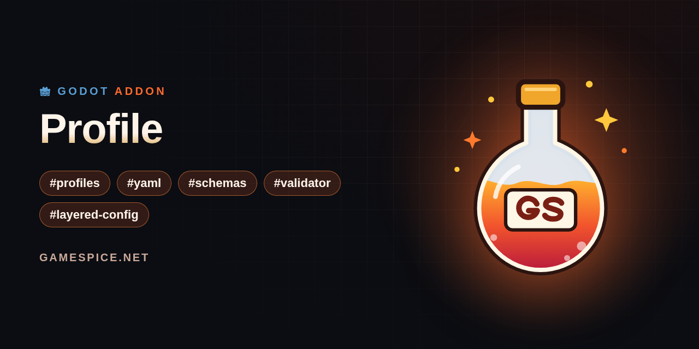

One YAML file per NPC, weapon or player class, instead of one big config.

- `GSProfileSet` lists, loads and validates all profiles of one kind.
- `GSProfile` is one loaded profile.
- `GSProfileRuntime` applies live edits on a server, gated by permission.

Features: tiers (addon, game, user, server), `extends`, `extra:` values, folder profiles with child sets, environment and command-line overrides, and a headless validator (`tools/profile_check.gd`).

## Install

1. Copy `addons/gs_profile/` and GameSpice Core's `addons/gs_core/` into your project.
2. Enable them in *Project > Project Settings > Plugins*.

Only GameSpice Core is required. Config paths and file formats are GameSpice Core's:

| Tier | Path |
| --- | --- |
| Addon | `cfg/addon/<addon>/` |
| Game | `cfg/game/<game>/` |
| Server addon | `cfg/server/addon/<addon>/` |
| Server game | `cfg/server/game/<game>/` |

These classes used to live in GameSpice Core (before API level 22); their names did not change. Full reference: [docs/profiles.md](docs/profiles.md).

## Develop

Link gs-core (`ln -s ../../gs-core/addons/gs_core addons/gs_core`), import the project once, then run the scenes in `examples/`: `profile_selftest`, `profile_runtime_selftest`, `profile_check_selftest` and `user_tier_selftest`.

## Used by

All fourteen games vendor it:

- [Fatal Contact](https://zeesgames.com/fatal-contact)
- [Airdrift](https://zeesgames.com/airdrift)
- [Playlot](https://zeesgames.com/playlot)
- [Hungario](https://zeesgames.com/hungario)
- [Buses From Hell](https://zeesgames.com/buses-from-hell)
- [Smash Copter](https://zeesgames.com/smash-copter)
- [Zombie Zone](https://zeesgames.com/zombie-zone)
- [Hide n Seek](https://zeesgames.com/hide-n-seek)
- [Prop Hunt](https://zeesgames.com/prop-hunt)
- [Murder Mystery](https://zeesgames.com/murder-mystery)
- [Deathrun](https://zeesgames.com/deathrun)
- [Wipeout](https://zeesgames.com/wipeout)
- [Dangerous Delivery](https://zeesgames.com/dangerous-delivery)
- [Look At Me](https://zeesgames.com/look-at-me)

The whole collection is at [zeesgames.com](https://zeesgames.com).

## Status and licence

Part of the [**GameSpice**](https://gamespice.net) platform: a family of Godot addons, MIT licensed and built with Claude Code. It has five headless scenes in `examples/` (`profile_selftest` and the others listed under Develop). The games in [Zee's Games](https://zeesgames.com) are built on GameSpice addons and run on live servers, so profile files like these are read in real play. Bugs: [issue tracker](https://github.com/gamespice-platform/profile/issues).

MIT licence, see [LICENSE](LICENSE). The only closed part of the [**GameSpice**](https://gamespice.net) platform is the web back end; you can use your own instead of GameSpice's.
